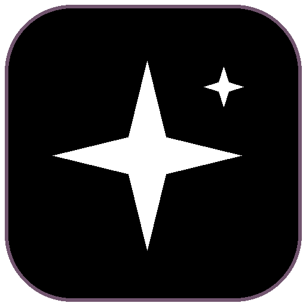
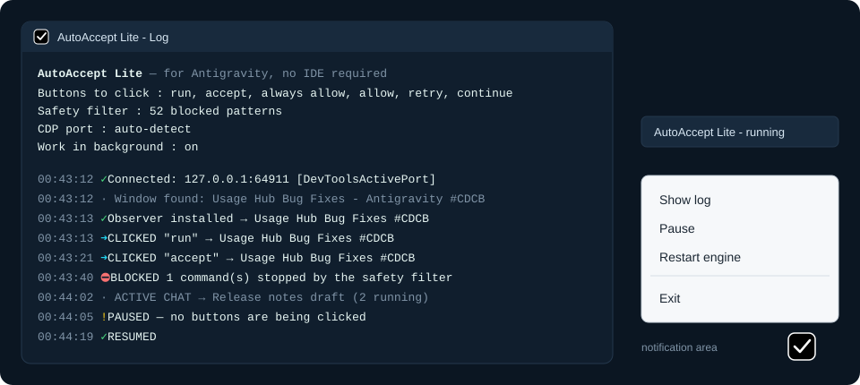
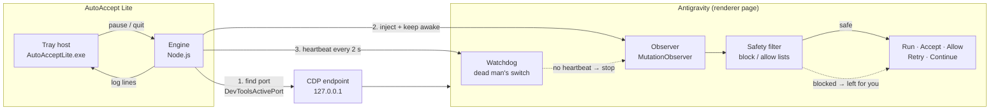

<div align="center">
  
  <h1>AutoAccept Lite</h1>
  <p><strong>A tiny Windows tray app that clicks Antigravity's approval buttons for you — no IDE, no extension, with a safety filter and a dead man's switch.</strong></p>

  <p>
    <strong>Language:</strong> <a href="README.md"><strong>EN</strong></a> | <a href="README.tr.md"><strong>TR</strong></a>
    &nbsp;•&nbsp;
    <a href="https://github.com/Hfatih/AutoAcceptLite/releases/latest">Download Release</a> ·
    <a href="#%EF%B8%8F-configuration">Configuration</a> ·
    <a href="#%EF%B8%8F-how-it-works">How It Works</a> ·
    <a href="#-support--sponsorship">Buy Me a Coffee</a>
  </p>

  <p>
    
    
    
    
    
    
    
    
  </p>
</div>

---

## ☕ Support & Sponsorship

If **AutoAccept Lite** saves you from babysitting approval prompts, consider supporting its development:

<div align="center">
  <a href="https://buymeacoffee.com/hfatih" target="_blank">
    
  </a>
  &nbsp;&nbsp;
  <a href="https://github.com/sponsors/Hfatih" target="_blank">
    
  </a>
  <p><sub><em>Your support keeps the project independent, free, and updated as Antigravity changes.</em></sub></p>
</div>

---

## 🚀 Overview

**AutoAccept Lite** watches the standalone **Antigravity** desktop app and presses its `Run`, `Accept`, `Always Allow`, `Retry` and `Continue` buttons the moment they appear, so long agent runs do not stall while you are away from the keyboard.

It lives in the Windows notification area, talks to Antigravity only over its own local Chrome DevTools Protocol endpoint on `127.0.0.1`, and installs nothing into Antigravity, VS Code or any extension host. Close the app and the page goes back to exactly how it was.

---

## 📸 Visual Tour

| **Tray Menu & Live Log** |
| :---: |
|  |
| *Every click, block and reconnect is logged; the tray tooltip shows running, paused or engine stopped.* |

---

## ✨ Key Features

### ⚡ Hands-Free Approvals
- **Clicks the buttons that block agent runs:** `Run`, `Accept`, `Always Allow`, `Allow this conversation`, `Allow`, `Retry`, `Continue`, plus any extra button texts you add.
- **Works while Antigravity is in the background:** Chromium throttles timers and stops rendering once a window is covered or minimized. The engine keeps the page awake, so approvals do not wait for you to bring the window back.
- **Follows several running conversations:** Antigravity only loads the selected conversation into the page. The engine cycles through conversations that are still running so each one gets its approvals.
- **Reconnects by itself:** start it before or after Antigravity; if Antigravity restarts, the engine finds the new port and carries on.

### 🛡️ Safety First
- **Command safety filter:** 52 destructive command patterns (`rm -rf /`, `format c:`, `git push --force`, `drop database`, piping into a shell, and more) are blocked by default. A blocked button is marked and left for you to decide.
- **Allow list:** optionally restrict auto-run to commands matching your own patterns. The block list always wins.
- **Dead man's switch:** the in-page observer needs a heartbeat from the engine every 2 seconds. If the engine dies, clicking stops within about 15 seconds and the observer removes itself.
- **Retry circuit breaker:** at most 3 `Retry` / `Continue` clicks per minute, so a failing step cannot loop forever.
- **Sidebar guard:** short words such as `run` in a conversation title are never mistaken for a button.

### 🪟 A Proper Tray App
- **No console window:** runs in the notification area with a status tooltip.
- **Show log:** a live view of connections, clicks and blocks.
- **Pause / Resume:** stop clicking without closing anything.
- **Restart engine:** apply `config.json` changes in one click.
- **Exit:** removes the observer from the page before closing.
- **Turkish and English:** the app and the installer follow the Windows display language.

### 🔒 100% Local & Zero Telemetry
- **Loopback only:** the single connection is to Antigravity's own CDP endpoint on `127.0.0.1`. It opens no debugging port of its own and never contacts another machine.
- **Nothing installed into Antigravity:** no extension, no patched files. Everything lives in the page's memory and disappears on exit.
- **No admin rights:** installs for the current user only, with Node.js bundled. It does not add itself to Windows startup.

---

## 🏗️ How It Works



1. **Discover.** Antigravity writes its debugging port to `%APPDATA%\Antigravity\DevToolsActivePort`. The engine reads it and verifies the endpoint.
2. **Inject.** For each renderer window it installs a watchdog and a `MutationObserver` that scans for matching buttons whenever the page changes.
3. **Filter and click.** Before pressing `Run`, the observer reads the command next to the button and checks it against the block and allow lists.
4. **Stay alive.** The engine refreshes a heartbeat, drains the click log into the tray, and keeps the page awake while Antigravity is hidden.

---

## 📥 Download and Installation

1. Download `AutoAcceptLite-Kurulum-<version>.exe` from the [Latest Release](https://github.com/Hfatih/AutoAcceptLite/releases/latest).
2. Run the installer. It installs for the current Windows user only and needs no administrator permission. Node.js is bundled.
3. Open **Antigravity**, then start **AutoAccept Lite** from its shortcut.
4. Look for the icon in the notification area (it may be behind the hidden-icons arrow). Hover over it to see the state.

Running a newer installer over an existing installation upgrades it and keeps your `config.json`.

> [!NOTE]
> The binaries are not signed with a trusted publisher certificate, so Windows SmartScreen or Smart App Control may warn or block them. Windows security settings are never changed by the installer.

Task Manager shows the app as two rows: **AutoAccept Lite** (tray host) and **Node.js JavaScript Runtime** (engine).

---

## ⚙️ Configuration

Settings live in `%LOCALAPPDATA%\Programs\AutoAcceptLite\app\config.json`. After editing, choose **Restart engine** from the tray menu.

| Key | Default | What it does |
| :--- | :--- | :--- |
| `autoAcceptFileEdits` | `true` | Click `Accept` on file edits. Set `false` to review edits yourself. |
| `autoRetryEnabled` | `true` | Click `Retry` and `Continue`. |
| `customButtonTexts` | `["submit"]` | Extra button texts to click, for example localized labels. |
| `useSafetyPresets` | `true` | Apply the built-in list of destructive command patterns. |
| `blockedCommands` | `[]` | Your own patterns that must never be auto-run. |
| `allowedCommands` | `[]` | If not empty, only commands matching these patterns are auto-run. |
| `keepActiveInBackground` | `true` | Keep the page awake while Antigravity is covered or minimized. |
| `autoCycleActiveConversations` | `true` | Cycle through conversations that are still running. |
| `conversationSwitchMs` | `1500` | Minimum time between conversation switches (500–30000). |
| `heartbeatMs` | `2000` | Scan and heartbeat interval (minimum 1000). |
| `maxConcurrentTargets` | `12` | Windows handled in parallel (1–64). |
| `language` | `"auto"` | `"auto"` follows Windows; `"tr"` or `"en"` forces one. |
| `port` | `null` | CDP port. `null` finds it automatically. |
| `verbose` | `false` | Log per-target errors for troubleshooting. |

---

## ⚠️ Safety Notes

- The safety filter is a guard rail, not a sandbox. If the command text next to a button cannot be read, a risky command may not be recognized.
- `customButtonTexts` contains `submit` by default. That can submit an empty answer and continue without your input; remove it if you do not want that.
- `keepActiveInBackground` makes Antigravity keep rendering while hidden, which uses some extra CPU/GPU.
- Review the defaults and pick settings that match how much you trust the agent with your machine.

---

## 🔨 Building from Source

### Prerequisites
- Windows 10/11 (x64)
- [Node.js](https://nodejs.org/) 22 or a compatible current release
- .NET Framework 4.x (ships with Windows) for the tray host
- [Inno Setup](https://jrsoftware.org/isinfo.php) 6 or later for the installer

### Development Mode
```powershell
# Clone the repository
git clone https://github.com/Hfatih/AutoAcceptLite.git
cd AutoAcceptLite

# Install the single dependency (ws)
npm ci

# Run the engine in a terminal: P pauses/resumes, Ctrl+C exits
npm start
```

### Windows Installer
```powershell
powershell -ExecutionPolicy Bypass -File packaging/windows/build.ps1
```
The installer is written to `packaging/windows/dist/`. See [`packaging/windows/README.md`](packaging/windows/README.md) for the runtime files the build expects.

### Running Tests
```powershell
node test/i18n.test.js
```

---

## 🩺 Troubleshooting

- **"Antigravity not found" in the log:** open Antigravity; the engine connects on its own. If you set `port` manually, make sure it is the right one.
- **The icon is there but nothing is clicked:** hover over the icon. *paused* means choose **Resume**; *engine stopped* means choose **Restart engine** and check the log.
- **Nothing happens when the shortcut is clicked:** the app may already be running; look behind the hidden-icons arrow.
- **A command you expected was not run:** it probably matched the safety filter. The log shows a `BLOCKED` line and the button is marked in the page.

---

## 📄 License & Disclaimer

Released under the [MIT License](LICENSE). `src/DOMObserver.js` is based on the MIT-licensed [AntiGravity-AutoAccept](https://github.com/yazanbaker94/AntiGravity-AutoAccept) project; its copyright and license notice are preserved in [`LICENSE.upstream`](LICENSE.upstream). The bundled Node.js runtime is covered by its own terms, shipped as `LICENSE.node.txt`. See also [third-party notices](THIRD-PARTY-NOTICES.md).

*AutoAccept Lite is an independent open-source project and is not affiliated with Google. Antigravity and other named products are trademarks of their respective owners. Automatically approving agent actions is done at your own risk.*
