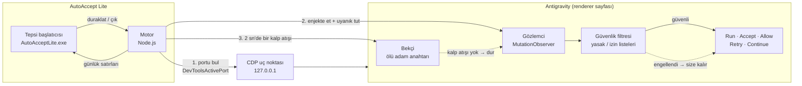

<div align="center">
  
  <h1>AutoAccept Lite</h1>
  <p><strong>Antigravity'nin onay düğmelerine sizin yerinize basan küçük bir Windows tepsi uygulaması — IDE ve eklenti gerektirmez; güvenlik filtresi ve ölü adam anahtarı içerir.</strong></p>

  <p>
    <strong>Dil:</strong> <a href="README.md"><strong>EN</strong></a> | <a href="README.tr.md"><strong>TR</strong></a>
    &nbsp;•&nbsp;
    <a href="https://github.com/Hfatih/AutoAcceptLite/releases/latest">Sürümü İndir</a> ·
    <a href="#%EF%B8%8F-ayarlar">Ayarlar</a> ·
    <a href="#%EF%B8%8F-nasıl-çalışır">Nasıl Çalışır</a> ·
    <a href="#-destek--sponsorluk">Bir Kahve Ismarla</a>
  </p>

  <p>
    
    
    
    
    
    
    
    
  </p>
</div>

---

## ☕ Destek & Sponsorluk

**AutoAccept Lite** sizi onay pencerelerinin başında beklemekten kurtarıyorsa geliştirilmesine destek olabilirsiniz:

<div align="center">
  <a href="https://buymeacoffee.com/hfatih" target="_blank">
    
  </a>
  &nbsp;&nbsp;
  <a href="https://github.com/sponsors/Hfatih" target="_blank">
    
  </a>
  <p><sub><em>Desteğiniz projenin bağımsız, ücretsiz ve Antigravity değiştikçe güncel kalmasını sağlar.</em></sub></p>
</div>

---

## 🚀 Genel Bakış

**AutoAccept Lite**, bağımsız **Antigravity** masaüstü uygulamasını izler ve `Run`, `Accept`, `Always Allow`, `Retry` ve `Continue` düğmelerine göründükleri anda basar; böylece uzun ajan çalışmaları siz klavyenin başında değilken takılıp kalmaz.

Windows bildirim alanında yaşar, Antigravity ile yalnızca onun kendi yerel Chrome DevTools Protocol uç noktası üzerinden (`127.0.0.1`) konuşur ve Antigravity'ye, VS Code'a ya da herhangi bir eklentiye hiçbir şey kurmaz. Uygulamayı kapattığınızda sayfa eski haline döner.

---

## 📸 Görsel Tur

| **Tepsi Menüsü & Canlı Günlük** |
| :---: |
|  |
| *Her tıklama, engelleme ve yeniden bağlanma günlüğe yazılır; tepsi ipucu çalışıyor, duraklatıldı ya da motor durdu bilgisini gösterir. (Arayüz Türkçe Windows'ta Türkçe açılır.)* |

---

## ✨ Öne Çıkan Özellikler

### ⚡ Elleriniz Serbest
- **Ajanı bekleten düğmelere basar:** `Run`, `Accept`, `Always Allow`, `Allow this conversation`, `Allow`, `Retry`, `Continue` ve sizin eklediğiniz özel düğme metinleri.
- **Antigravity arka plandayken de çalışır:** Chromium, pencere örtüldüğünde ya da küçültüldüğünde zamanlayıcıları kısar ve çizimi durdurur. Motor sayfayı uyanık tutar; onaylar pencereyi öne almanızı beklemez.
- **Birden fazla çalışan sohbeti izler:** Antigravity yalnızca seçili sohbeti sayfaya yükler. Motor hâlâ çalışan sohbetler arasında dolaşır, her biri kendi onayını alır.
- **Kendiliğinden yeniden bağlanır:** Antigravity'den önce ya da sonra başlatabilirsiniz; Antigravity yeniden açılırsa motor yeni portu bulup devam eder.

### 🛡️ Önce Güvenlik
- **Komut güvenlik filtresi:** 52 yıkıcı komut kalıbı (`rm -rf /`, `format c:`, `git push --force`, `drop database`, kabuğa boruyla aktarma ve benzerleri) varsayılan olarak engellenir. Engellenen düğme işaretlenir ve karar size bırakılır.
- **İzin listesi:** isterseniz otomatik çalıştırmayı yalnızca kendi kalıplarınıza uyan komutlarla sınırlayabilirsiniz. Yasak listesi her zaman önceliklidir.
- **Ölü adam anahtarı:** sayfadaki gözlemci, motordan 2 saniyede bir kalp atışı bekler. Motor ölürse tıklama yaklaşık 15 saniye içinde durur ve gözlemci kendini kaldırır.
- **Yeniden deneme sigortası:** dakikada en fazla 3 `Retry` / `Continue` tıklaması yapılır; başarısız bir adım sonsuz döngüye giremez.
- **Kenar çubuğu koruması:** sohbet başlığında geçen `run` gibi kısa sözcükler düğme sanılmaz.

### 🪟 Düzgün Bir Tepsi Uygulaması
- **Konsol penceresi yok:** bildirim alanında, durum ipucuyla çalışır.
- **Günlüğü göster:** bağlantıları, tıklamaları ve engellemeleri canlı izleyin.
- **Duraklat / Devam et:** hiçbir şeyi kapatmadan tıklamayı durdurun.
- **Motoru yeniden başlat:** `config.json` değişikliklerini tek tıkla uygulayın.
- **Çıkış:** kapanmadan önce gözlemciyi sayfadan kaldırır.
- **Türkçe ve İngilizce:** uygulama ve kurulum sihirbazı Windows görüntüleme diline uyar.

### 🔒 %100 Yerel & Telemetri Yok
- **Yalnızca yerel bağlantı:** tek bağlantı Antigravity'nin `127.0.0.1` üzerindeki kendi CDP uç noktasınadır. Kendi hata ayıklama portunu açmaz, başka bir makineye bağlanmaz.
- **Antigravity'ye hiçbir şey kurulmaz:** eklenti yok, değiştirilen dosya yok. Her şey sayfanın belleğinde yaşar ve çıkışta kaybolur.
- **Yönetici izni gerekmez:** yalnızca geçerli kullanıcıya kurulur, Node.js pakete dahildir. Windows açılışına kendini eklemez.

---

## 🏗️ Nasıl Çalışır



1. **Bul.** Antigravity hata ayıklama portunu `%APPDATA%\Antigravity\DevToolsActivePort` dosyasına yazar. Motor bunu okur ve uç noktayı doğrular.
2. **Enjekte et.** Her renderer penceresine bir bekçi ve sayfa değiştikçe eşleşen düğmeleri tarayan bir `MutationObserver` kurar.
3. **Süz ve tıkla.** Gözlemci `Run` düğmesine basmadan önce yanındaki komutu okur, yasak ve izin listeleriyle karşılaştırır.
4. **Canlı tut.** Motor kalp atışını tazeler, tıklama kaydını tepsiye aktarır ve Antigravity gizliyken sayfayı uyanık tutar.

---

## 📥 İndirme ve Kurulum

1. [Son Sürüm](https://github.com/Hfatih/AutoAcceptLite/releases/latest) sayfasından `AutoAcceptLite-Kurulum-<sürüm>.exe` dosyasını indirin.
2. Kurulumu çalıştırın. Yalnızca geçerli Windows kullanıcısına kurulur, yönetici izni istemez. Node.js pakete dahildir.
3. **Antigravity**'yi açın, ardından kısayolundan **AutoAccept Lite**'ı başlatın.
4. Bildirim alanındaki simgeyi bulun (gizli simgeler okunun arkasında olabilir). Fareyi üzerine getirince durumu görürsünüz.

Yeni kurulum dosyasını mevcut kurulumun üzerine çalıştırmak uygulamayı günceller ve `config.json` dosyanızı korur.

> [!NOTE]
> Dosyalar güvenilir yayıncı sertifikasıyla imzalanmamıştır; Windows SmartScreen ya da Smart App Control uyarı verebilir veya engelleyebilir. Kurulum, Windows güvenlik ayarlarını hiçbir zaman değiştirmez.

Görev Yöneticisi'nde uygulama iki satır olarak görünür: **AutoAccept Lite** (tepsi başlatıcısı) ve **Node.js JavaScript Runtime** (motor).

---

## ⚙️ Ayarlar

Ayarlar `%LOCALAPPDATA%\Programs\AutoAcceptLite\app\config.json` dosyasındadır. Düzenledikten sonra tepsi menüsünden **Motoru yeniden başlat**'ı seçin.

| Anahtar | Varsayılan | Ne yapar |
| :--- | :--- | :--- |
| `autoAcceptFileEdits` | `true` | Dosya düzenlemelerinde `Accept`'e basar. Düzenlemeleri kendiniz incelemek için `false` yapın. |
| `autoRetryEnabled` | `true` | `Retry` ve `Continue` düğmelerine basar. |
| `customButtonTexts` | `["submit"]` | Basılacak ek düğme metinleri, örneğin yerelleştirilmiş etiketler. |
| `useSafetyPresets` | `true` | Hazır yıkıcı komut kalıpları listesini uygular. |
| `blockedCommands` | `[]` | Asla otomatik çalıştırılmayacak kendi kalıplarınız. |
| `allowedCommands` | `[]` | Boş değilse yalnızca bu kalıplara uyan komutlar otomatik çalışır. |
| `keepActiveInBackground` | `true` | Antigravity örtülüyken ya da küçültülmüşken sayfayı uyanık tutar. |
| `autoCycleActiveConversations` | `true` | Hâlâ çalışan sohbetler arasında dolaşır. |
| `conversationSwitchMs` | `1500` | İki sohbet geçişi arasındaki en kısa süre (500–30000). |
| `heartbeatMs` | `2000` | Tarama ve kalp atışı aralığı (en az 1000). |
| `maxConcurrentTargets` | `12` | Aynı anda işlenen pencere sayısı (1–64). |
| `language` | `"auto"` | `"auto"` Windows'u izler; `"tr"` ya da `"en"` dili sabitler. |
| `port` | `null` | CDP portu. `null` otomatik bulur. |
| `verbose` | `false` | Sorun gidermek için hedef başına hataları günlüğe yazar. |

---

## ⚠️ Güvenlik Notları

- Güvenlik filtresi bir korkuluktur, karantina değildir. Düğmenin yanındaki komut metni okunamazsa riskli bir komut tanınmayabilir.
- `customButtonTexts` varsayılan olarak `submit` içerir. Bu, boş bir yanıtı gönderip siz yazmadan devam edebilir; istemiyorsanız kaldırın.
- `keepActiveInBackground`, Antigravity'nin gizliyken de çizim yapmasına yol açar; bu biraz daha fazla CPU/GPU kullanır.
- Varsayılanları gözden geçirin ve ajana bilgisayarınızda ne kadar güvendiğinize uygun ayarları seçin.

---

## 🔨 Kaynaktan Derleme

### Gereksinimler
- Windows 10/11 (x64)
- [Node.js](https://nodejs.org/) 22 ya da uyumlu güncel bir sürüm
- Tepsi başlatıcısı için .NET Framework 4.x (Windows ile gelir)
- Kurulum dosyası için [Inno Setup](https://jrsoftware.org/isinfo.php) 6 veya üstü

### Geliştirme Modu
```powershell
# Depoyu klonlayın
git clone https://github.com/Hfatih/AutoAcceptLite.git
cd AutoAcceptLite

# Tek bağımlılığı (ws) kurun
npm ci

# Motoru terminalde çalıştırın: P duraklatır/devam ettirir, Ctrl+C çıkar
npm start
```

### Windows Kurulum Dosyası
```powershell
powershell -ExecutionPolicy Bypass -File packaging/windows/build.ps1
```
Kurulum dosyası `packaging/windows/dist/` klasörüne yazılır. Derlemenin beklediği çalışma zamanı dosyaları için [`packaging/windows/README.md`](packaging/windows/README.md) dosyasına bakın.

### Testleri Çalıştırma
```powershell
node test/i18n.test.js
```

---

## 🩺 Sorun Giderme

- **Günlükte "Antigravity bulunamadı":** Antigravity'yi açın; motor kendiliğinden bağlanır. `port` değerini elle verdiyseniz doğru olduğundan emin olun.
- **Simge duruyor ama hiçbir şeye basılmıyor:** fareyi simgenin üzerine getirin. *duraklatıldı* ise **Devam et**'i, *motor durdu* ise **Motoru yeniden başlat**'ı seçip günlüğe bakın.
- **Kısayola tıklayınca hiçbir şey olmuyor:** uygulama zaten çalışıyor olabilir; gizli simgeler okunun arkasına bakın.
- **Beklediğiniz bir komut çalıştırılmadı:** büyük olasılıkla güvenlik filtresine takıldı. Günlükte `ENGELLENDİ` satırı görünür ve düğme sayfada işaretlenir.

---

## 📄 Lisans & Sorumluluk Reddi

[MIT Lisansı](LICENSE) ile yayınlanır. `src/DOMObserver.js`, MIT lisanslı [AntiGravity-AutoAccept](https://github.com/yazanbaker94/AntiGravity-AutoAccept) projesine dayanır; özgün telif ve lisans bildirimi [`LICENSE.upstream`](LICENSE.upstream) içinde korunur. Pakete dahil Node.js çalışma zamanı kendi koşullarına tabidir ve `LICENSE.node.txt` olarak gelir. Ayrıca [üçüncü taraf bildirimlerine](THIRD-PARTY-NOTICES.md) bakın.

*AutoAccept Lite bağımsız bir açık kaynak projedir ve Google ile bağlantılı değildir. Antigravity ve adı geçen diğer ürünler ilgili sahiplerinin ticari markalarıdır. Ajan eylemlerini otomatik onaylamanın sorumluluğu size aittir.*
